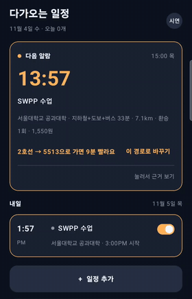
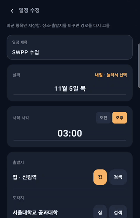
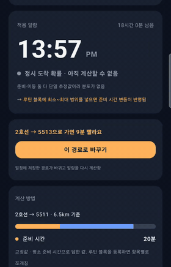
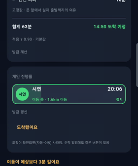

# JustInTime — Iteration 3 Demo

**An alarm you set by arrival confidence, not by clock time.**

You pick how sure you want to be of arriving on time — τ, e.g. 0.90 for a class, 0.99
for an exam — and the app works backwards from the event:

```
alarm = event start − safety buffer − τ-quantile of (prep + travel)
```

From Iteration 3 the safety buffer is learned per user: 5 minutes to start, then raised when
you are late more often than τ promised and lowered when you never needed it (4–15 min).

| | |
| --- | --- |
| Iteration | 3 · 2026-10-26 – 2026-11-06 |
| Snapshot | App and server code of `main` at `5dc51ef` (2026-11-05), the final Iteration 3 snapshot; this branch adds the README, the demo videos and [`qa/demo/iter3_e2e.py`](qa/demo/iter3_e2e.py) |
| Version | Server 0.20.0 (`APP_VERSION`, deployed) · app `versionName` 0.14.0 |
| Server | `https://justintime-api.onrender.com` ([`/api/health`](https://justintime-api.onrender.com/api/health)) |
| Demo video | [`iteration3_demo.mp4`](iteration3_demo.mp4) (44 s, four scenes) · the clips one by one in [`demo-video/`](demo-video/) |

Everything needed to run the demo is on this page. The full project README
(architecture, API, deployment, configuration) is on
[`main`](https://github.com/snuhcs-course/swpp-2026-project-team-18/blob/main/README.md);
the earlier demos are on
[`iteration-1-demo`](https://github.com/snuhcs-course/swpp-2026-project-team-18/tree/iteration-1-demo)
and [`iteration-2-demo`](https://github.com/snuhcs-course/swpp-2026-project-team-18/tree/iteration-2-demo).

**Contents:** [Demo video](#demo-video) · [What the demo shows](#what-the-demo-shows) ·
[Major progress in Iteration 3](#major-progress-in-iteration-3) ·
[Tech stack and environment](#tech-stack-and-environment) · [How to run](#how-to-run) ·
[Automated end-to-end run](#automated-end-to-end-run) ·
[Known limitations and todos](#known-limitations-and-todos) · [Verification](#verification)

---

## Demo video

**[▶ iteration3_demo.mp4](iteration3_demo.mp4)** — 44 s, no audio: the four clips below joined
in order. Each clip is also in [`demo-video/`](demo-video/).

All four were recorded on a physical Android phone against a local server with a test account.
The event is a class tomorrow at 15:00 at the SNU College of Engineering, leaving from Sillim
Station. The same scenario runs end to end without a phone in the
[automated run](#automated-end-to-end-run).

Previews (GIF, no sound; click one to open its video):

<table>
  <tr>
    <td align="center"><a href="demo-video/iteration3_demo_1.mp4"></a><br><b>1 · Faster route before the alarm</b></td>
    <td align="center"><a href="demo-video/iteration3_demo_2.mp4"></a><br><b>2 · Edit and route candidates</b></td>
  </tr>
  <tr>
    <td align="center"><a href="demo-video/iteration3_demo_3.mp4"></a><br><b>3 · Reroute when late</b></td>
    <td align="center"><a href="demo-video/iteration3_demo_4.mp4"></a><br><b>4 · Arrival by hand</b></td>
  </tr>
</table>

| Clip | Length | What it shows |
| --- | --- | --- |
| [1 · Faster route before the alarm](demo-video/iteration3_demo_1.mp4) | 8 s | The event was saved on purpose with a slow route (2호선 → 5511, 33 min). The next-alarm card on Home says "2호선 → 5513으로 가면 9분 빨라요" (9 minutes faster via 2호선 → 5513). "이 경로로 바꾸기" (switch to this route) changes the saved route, the alarm moves from 13:57 to 14:06, and the offer disappears |
| [2 · Edit the event and the route candidates](demo-video/iteration3_demo_2.mp4) | 12 s | On the edit screen, "변경" (change) next to the route opens route choice. The fastest transit candidate (24 min) shows its stops and times per leg; scrolling shows the 25- and 26-minute candidates with the "최소 비용" (cheapest) and "최소 도보" (least walking) badges |
| [3 · Reroute when late on the way](demo-video/iteration3_demo_3.mp4) | 15 s | The demo tool's "이동하기" (move) walks a fake location along the route. Moving the start earlier on the server makes the trip late: a heads-up notification and the card "지금 경로로는 9분 늦어요 · 6515 → 5513으로 가면 6분 덜 늦어요" (9 minutes late now; 6 minutes less late via 6515 → 5513). "이 경로로 바꾸기" shows "경로를 바꿨습니다" (route changed) and redraws the map. In demo mode this change is not sent to the server |
| [4 · Arrival by hand](demo-video/iteration3_demo_4.mp4) | 9 s | On the in-transit progress card, "도착했어요" (I've arrived) turns the state into "도착 완료 · 정시" (arrived · on time) |

The demo tool in clip 3 (move the location, fast-forward time) belongs to the build used for the
heuristic evaluation (`dev` branch) and is not on this branch. Here, move an emulator with its
location controls ([step 8](#8-demo-tips)), or run the scene through the API with the
[automated run](#automated-end-to-end-run).

---

## What the demo shows

Iteration 1 built one flow end to end: sign up, add an event, let the server compute the
alarm, have it ring, and record the trip. Iteration 2 made that flow trustworthy and started
learning from it. **Iteration 3 lets you correct the plan, and makes the learning personal**:
saved events can be edited or skipped, arrival can be recorded by hand, a late trip offers a
better route, and the buffer, prep time and travel time are learned from your own mornings.

### Features implemented (whole app, as of this snapshot)

| # | Feature | What to look for |
| --- | --- | --- |
| 1 | Sign up and sign in | Email with a server-checked password, or **Kakao and Google**; terms consent; **forgot and change password**; show/hide password and the last email remembered |
| 2 | Onboard | Home by address or place search, prep time on a clock dial (5–240 min), an optional screen to link device calendars |
| 3 | Add an event | Title, date, time, **event type** (sets τ; add your own with "+ 추가"), destination by place search, a pick on the map or a saved home, origin home by default, a weekly repeat. Leaving from somewhere other than home asks whether to include prep time |
| 4 | Choose a route | Candidates grouped by transit, walk, bicycle and car. **Up to seven transit routes** that differ in what they optimize (fastest, fewest transfers, least walking, subway only, bus only, cheapest…); routes that differ only by bus number are **one card listing every bus**. The default is **the route you chose last time**, else the fastest |
| 5 | See the alarm and why | Prep, travel and **safety buffer** add up to start − alarm exactly, each labeled estimated, observed, learned or fixed, with the route map and a faster alternative if there is one |
| 6 | Change a saved event | An **edit screen** from the decision screen (only changed fields are sent), **"안 감"** (not going) to turn its alarm off and keep it out of learning, the risk choice (safe / normal / gamble) and delete |
| 7 | Wake up reliably | Full screen over the lock screen, 5-min snooze, re-registered after reboot and app update; only the first alarm of each day on by default. **If a force-stop cleared an alarm, Home says so** |
| 8 | Commute | Departure and arrival detected on the device; the live fastest route from your position in purple; **the stops of the planned route** and **one line on why you are late**. If the current route will make you late and another arrives earlier, a **heads-up notification offers to switch** for this trip only. **"도착했어요"** records arrival by hand when GPS misses it |
| 9 | Before you leave | A faster route offered before the alarm, and up to two checks after the alarm is off and 10 minutes before leaving |
| 10 | Learn | Every night at 23:17 KST: **your safety buffer** from your lateness history, **prep time from GPS departures** (only mornings within 0.5–1.5× of your set prep), **your walking speed and time-of-day factors**, then the route correction; the next 7 days of alarms are recomputed without a new route lookup |
| 11 | Review | A weekly report with a written summary (LLM, with a fixed-sentence fallback), a per-day detail and calibration |

The app's text is Korean.

---

## Major progress in Iteration 3

Compared with [`iteration-2-demo`](https://github.com/snuhcs-course/swpp-2026-project-team-18/tree/iteration-2-demo)
(`e3698d7`, 2026-10-21): 59 commits. Sooyeon Kim did the backend, Jinho Kim the app and Figma,
and Junha Park was the PM. Design notes for each item are in [`docs/iter3/`](docs/iter3/)
(mostly Korean); the app work is listed per commit in
[`docs/iter3/front-iter3.md`](docs/iter3/front-iter3.md).

**Learning**

- Safety buffer learned from each user's lateness history: 5 minutes to start, 4–15 minutes,
  changed only after at least three mornings (US-30)
- Prep time learned from GPS departures as well as prep blocks; mornings far from the set prep
  time (going back to sleep, leaving early) are left out (US-31)
- Walking speed and time-of-day factors for travel time
  ([`travel-factors.md`](docs/iter3/travel-factors.md))
- After the nightly training, the next 7 days of alarms are recomputed without calling Kakao again

**Events and routes**

- Edit a saved event; the server recomputes only what changed
  ([`event-edit-api.md`](docs/iter3/event-edit-api.md))
- "안 감" (not going), prep time switch for other origins, several homes kept on the device
- User-created event types with their own τ (BE-21)
- Up to seven varied transit candidates, bus-number variants merged into one card, the default
  route from your past choice, the walk candidate always sent, the bike-road share of bicycle
  routes (BE-14)
  ([`transit-candidates.md`](docs/iter3/transit-candidates.md))
- Event creation is retry-safe and keeps the event when the alarm computation fails; server
  errors come back as JSON

**On the way**

- Reroute when late in transit: a heads-up notification and a card, held back while riding and
  near arrival ([`reroute-api.md`](docs/iter3/reroute-api.md))
- The stops of the planned route and a one-line late cause (late start or a longer trip)
- "도착했어요" on the trip card and the tracking notification
- Replanning before departure: a faster route before the alarm and up to two checks before leaving
- Fixed the four known bugs of Iteration 2: the arrival result and the moving state are restored
  after a restart, map panning no longer jumps twice as far, and a small pinch no longer snaps a
  whole zoom level

**Accounts and security**

- Kakao and Google sign-in with the providers' ID tokens
  ([`social-login-api.md`](docs/iter3/social-login-api.md)), link and unlink in Settings
- Forgot password with a 6-digit code, change password, email format check
  ([`password-api.md`](docs/iter3/password-api.md))
- Logout revokes the refresh token; tokens are stored encrypted with the Android Keystore and no
  longer printed in debug logs ([`token-security-api.md`](docs/iter3/token-security-api.md))

**Design**

- An app logo; Figma frames F-18 ~ F-45 for every new screen
  ([`figma-changes.md`](docs/iter3/figma-changes.md)); a shorter applied-alarm card and the
  safety buffer shown in the breakdown

**Testing** (CI run 92 on `5dc51ef`, all passed)

- Backend tests 1,257 → 1,795 (95.6% line coverage), app JVM tests 729 → 950, 34 device tests
- Five of seven coverage targets met; ViewModel and Platform are below target. Details are in the
  Wiki's [Testing Documentation, Iteration 3](https://github.com/snuhcs-course/swpp-2026-project-team-18/wiki/team18%E2%80%90iter3%E2%80%90testing)
- A heuristic evaluation by other teams on 11-04; its findings are in section 7 of the same page

---

## Tech stack and environment

| Part | Stack |
| --- | --- |
| App | Kotlin, Jetpack Compose (Material 3), Retrofit + OkHttp, Room, WorkManager, Google Play services Location, Kakao SDK and Credential Manager for sign-in, Android Keystore for tokens · minSdk 34, targetSdk 37 · AGP 9.3, Gradle 9.5 |
| Server | Python 3.12, Django 5.2, Django REST Framework, SimpleJWT, gunicorn · Docker on Render (free plan, Singapore) |
| Database | Neon Postgres |
| Scheduled jobs | GitHub Actions (`train-models.yml`: buffer, prep and travel training, then the 7-day recompute, daily at 23:17 KST) |
| External APIs | Kakao (routes, place search, static maps, sign-in), Google sign-in, Seoul real-time subway and bus arrivals, an OpenAI-compatible LLM for the report summary — routes, maps and the LLM are called by the server only |

Development and test environment:

- **App development:** Android Studio with its bundled JBR, Android SDK Platform 37; each new
  screen checked on an emulator against a local server with a throwaway database
- **Backend development:** Python 3.12; read-only checks on the production database and on a
  Galaxy phone over adb
- **APK for the heuristic evaluation (11-04):** built on macOS (Apple Silicon) with Android
  Studio's JBR; installed on a Galaxy S22 and a Galaxy S23 Ultra
- **CI:** GitHub Actions on Ubuntu; app integration tests on an API 34 emulator

The design behind it is in the Wiki's
[Design Documentation](https://github.com/snuhcs-course/swpp-2026-project-team-18/wiki/team18%E2%80%90iter1%E2%80%90design)
(v3.0 for Iteration 3) and the requirements in the
[Requirements Specification](https://github.com/snuhcs-course/swpp-2026-project-team-18/wiki/team18%E2%80%90iter1%E2%80%90reqspec).

---

## How to run

No backend setup is needed: every build talks to the shared server above.

### Quick start

1. `git clone -b iteration-3-demo https://github.com/snuhcs-course/swpp-2026-project-team-18.git`
2. In Android Studio, open the **`APP`** folder and wait for Gradle Sync.
3. Start an emulator (Google Play image) or connect a phone, on Android 14 (API 34) or newer.
4. Press **Run ▶**, allow notifications and precise location, then **sign up with an email**
   and add an event.

The first request after 15 idle minutes wakes the server and takes 30–60 seconds. Kakao and
Google sign-in work only with an APK signed by a key registered in their consoles (step 7), so
use email sign-up on your own build.

### 1. Requirements

- **Android Studio**, a recent version. Its bundled JDK (JBR) is what Gradle uses
- **Android SDK Platform 37**. Android Studio offers to install it during the first sync;
  otherwise use **Tools → SDK Manager**
- An **emulator or phone with Android 14 (API 34) or newer**. Emulators need a
  **Google Play** or **Google APIs** system image, because location and Google sign-in use
  Google Play services. On Apple Silicon, use an ARM64 image
- Internet access

### 2. Get the code

```bash
git clone -b iteration-3-demo https://github.com/snuhcs-course/swpp-2026-project-team-18.git
cd swpp-2026-project-team-18
```

### 3. Build and install

**Android Studio (recommended)**

1. **File → Open** and choose the **`APP` folder** inside the repository, not the
   repository root. Wait for Gradle Sync to finish.
2. **Device Manager** → create a phone with an API 34+ Google Play image, and start it.
3. Select the device and press **Run ▶**. JustInTime opens on the login screen.
4. The Build output should show
   `[JustInTime] API=https://justintime-api.onrender.com/`. If it shows another address,
   delete the `devServerHost=` line from `APP/local.properties` and run again.

**Terminal** — start an emulator or connect a phone first, then from the repository root:

```bash
# macOS
export JAVA_HOME="/Applications/Android Studio.app/Contents/jbr/Contents/Home"
export ANDROID_HOME="$HOME/Library/Android/sdk"
export PATH="$ANDROID_HOME/platform-tools:$PATH"
cd APP
./gradlew installDebug
adb shell am start -n com.swpp.wakeup/.ui.auth.LoginActivity
```

```powershell
# Windows PowerShell
$env:JAVA_HOME = "C:\Program Files\Android\Android Studio\jbr"
$env:ANDROID_HOME = "$env:LOCALAPPDATA\Android\Sdk"
$env:Path = "$env:ANDROID_HOME\platform-tools;$env:Path"
cd APP
.\gradlew.bat installDebug
adb shell am start -n com.swpp.wakeup/.ui.auth.LoginActivity
```

Change the paths if Android Studio or the SDK is installed elsewhere. With more than one
device, add `-s <device-id>` to `adb` (`adb devices -l` lists the IDs). The APK is written to
`APP/app/build/outputs/apk/debug/app-debug.apk`.

If an older JustInTime signed on another computer is already on the phone, Android refuses to
install over it; uninstall it first. Events and settings are on the server and come back after
you sign in again.

### 4. Set up the emulator once

```bash
# Time zone. The default (GMT) puts every time 9 hours off
adb shell cmd alarm set-timezone Asia/Seoul

# Show the on-screen keyboard, needed to type Korean place names
adb shell settings put secure show_ime_with_hard_keyboard 1
```

Then add a Korean keyboard in the emulator (Gboard → Languages → Add keyboard → 한국어).

### 5. Permissions

When the app asks, allow **notifications** and **precise location**. "While using the app" is
enough: tracking runs in a foreground service that starts when you dismiss the alarm. On
Android 14 and newer, **full-screen notifications** must also be allowed for the alarm to open
over the lock screen. The **calendar** permission is asked only if you link a calendar. To grant
them from a terminal:

```bash
adb shell pm grant com.swpp.wakeup android.permission.POST_NOTIFICATIONS
adb shell pm grant com.swpp.wakeup android.permission.ACCESS_FINE_LOCATION
adb shell pm grant com.swpp.wakeup android.permission.ACCESS_COARSE_LOCATION
adb shell pm grant com.swpp.wakeup android.permission.READ_CALENDAR
adb shell appops set com.swpp.wakeup USE_FULL_SCREEN_INTENT allow
```

Check that the device volume is up.

### 6. On a phone instead of an emulator

- **USB**: Settings → About phone → tap *Build number* 7 times, then turn on *USB debugging* in
  Developer options. Connect the cable and accept the prompt on the phone.
- **Wireless** (Android 11+): put the phone and the computer on the same network, pair from
  Developer options → *Wireless debugging* → *Pair device with pairing code* with
  `adb pair <IP>:<pairing-port>`, then `adb connect <IP>:<port>`. Networks that block
  device-to-device traffic, such as campus Wi-Fi, stop this; use USB instead.
- `adb devices -l` should list the phone as `device`. Then use step 3, or
  `adb -s <device-id> install -r APP/app/build/outputs/apk/debug/app-debug.apk`.

More on phones, including battery settings: [docs/device-setup.md](docs/device-setup.md).

### 7. Accounts and the server

Create your own account with an email for the demo. Sign-up allows 10 attempts per network
address per hour. **Kakao and Google** sign-in also work on the shared server, but only from an
APK whose signing key is registered in the Kakao and Google consoles; a debug build from another
computer gets a key-hash or client error. How to register a key is in
[APP/README.md](APP/README.md#소셜-로그인) and
[`backend-requests.md`](docs/iter3/backend-requests.md) (R3-4).

The server is on Render's free plan and sleeps after 15 minutes idle. The first request then
takes 30–60 seconds, and the login screen says it is waking the server
("서버를 깨우는 중…"). [`/api/health`](https://justintime-api.onrender.com/api/health)
should report `"version": "0.20.0"`.

### 8. Demo tips

- **Trying the Iteration 3 features**
  - *Transit routes*: add an event to a place across the city and open the transit tab — up
    to seven cards, with "(대체 N개)" on cards that merge bus numbers.
  - *Edit*: open an event, then "일정 수정" at the bottom. Changing the place or origin asks
    for the route again.
  - *Not going*: "안 감으로 표시" turns the alarm off and leaves the event out of learning.
  - *Event types*: in the type list, "+ 추가" makes your own type with its τ.
  - *Other origin*: pick an origin other than home and choose whether prep time is included.
  - *Arrival by hand*: during a trip, "도착했어요" on the trip card or the notification.
  - *Reroute*: while moving, if the current route will be late and another is earlier, a
    heads-up notification and a banner offer "이 경로로 바꾸기".
  - *Password*: "비밀번호 찾기" on the login screen resets it with a 6-digit code from email;
    Settings → 비밀번호 changes it.
- **Getting the alarm in a few minutes**: set the start to about *now + prep + travel +
  buffer (5 min for a new account) + 3–5 min*, then check the alarm time the server computed.
  If it is already past, use "일정 수정" to move the start later.
- Only the first alarm of the day rings by default. Turn others on with the switch on Home.
- Test with real time; don't change the device clock.
- **Moving the emulator**: open the emulator's **⋯ → Location**.
  - Before dismissing the alarm, send a **Single point** at your saved home.
  - For the trip, use **Routes** from home to the destination and **Play route** at 1×.
  - Or from a terminal: `adb emu geo fix <longitude> <latitude>` — longitude first,
    e.g. `adb emu geo fix 126.929745 37.484267` (Sillim Station).
- **Departure** is detected after 2 fixes in a row at least 150 m from home, or after 80 m of
  movement spread over at least 60 s. **Arrival** is the first valid fix within **100 m** of the
  destination coordinates saved with the event.

### 9. Troubleshooting

Tap the avatar on Home to open **Settings**. It shows the registered alarms and the next one,
alarms that couldn't be computed, the location permission, the linked calendars and sign-in
providers, and trip records not uploaded yet.

| Problem | Check, in this order |
| --- | --- |
| Can't sign in | Server address (build output or Settings) → [`/api/health`](https://justintime-api.onrender.com/api/health) → the message on screen. After idle, the first request takes up to a minute |
| Kakao or Google sign-in fails | The APK's signing key is not registered (step 7); use email sign-up |
| Sign-up refused with "too many requests" | The 10-per-hour limit; wait, or use another network |
| Install fails with a signature error | An older build from another computer is installed; uninstall it (step 3) |
| Times are 9 hours off | The emulator time zone (step 4) |
| Alarm doesn't ring or doesn't open full screen | The alarm time is in the future and registered (Settings, or `adb shell dumpsys alarm` and look for `com.swpp.wakeup`) → time zone → notification and full-screen permissions → volume and power saving |
| No trip recorded | Tracking starts only when you dismiss the alarm → precise location permission → enough GPS movement (tips above) → "올리지 못한 이동 기록" (records not uploaded) in Settings |
| Arrival not detected | Distance to the saved destination is under 100 m, or tap "도착했어요" |
| Can't type Korean | On-screen keyboard setting and a Korean keyboard (step 4) |
| Gradle Sync or build fails | SDK Platform 37 installed (SDK Manager) → Gradle JDK set to Android Studio's bundled JDK (Settings → Build, Execution, Deployment → Build Tools → Gradle) |
| The app talks to a local server | Delete `devServerHost=` from `APP/local.properties` and build again |

Logs:

```bash
adb logcat -s AlarmScheduler AlarmReceiver TripTrackingService TripObservationQueue
adb shell dumpsys alarm
```

Debug builds no longer print tokens, but logs still contain locations; don't share them.

---

## Automated end-to-end run

[`qa/demo/iter3_e2e.py`](qa/demo/iter3_e2e.py) runs the four scenes of the demo video end to end
through the real server API, with a new demo account and the same event: a class tomorrow at
15:00 at the SNU College of Engineering, leaving from Sillim Station.

| Scene | What the script does | Passes when |
| --- | --- | --- |
| 1 · Faster route before the alarm | Lists the transit candidates, saves the event with the slowest one, then switches to the faster route the server offers (`alt_route_key`) | The server offers a faster route and the alarm moves later after the switch |
| 2 · Edit and route candidates | Lists the candidates with their badges and edits the saved event | At least two transit candidates; the edit is saved and the route kept |
| 3 · Reroute when late | Rides the slow route again, moves the start close to now, uploads a departure from Sillim Station and asks for the live route | The live route is judged late; when an earlier route exists, `switch_suggestion` is sent back with `POST /events/{id}/reroute` |
| 4 · Arrival by hand | Uploads a manual arrival (`detector=manual`) | The server stores it and the arrival is on time against the moved start |

**Local server (default).** The script starts a throwaway server with the code of this branch
and an SQLite database under `.artifacts/demo-iter3/`; the shared database is never touched.
It needs the backend environment and the Kakao keys in `backend/.env`
([backend/README.md](backend/README.md)).

```bash
python3.12 -m venv backend/.venv
backend/.venv/bin/python -m pip install -r backend/requirements/dev.txt
backend/.venv/bin/python qa/demo/iter3_e2e.py
```

**Shared server.** No keys or local setup are needed, but each run creates a demo account there
(sign-up allows 10 per hour per network address):

```bash
backend/.venv/bin/python qa/demo/iter3_e2e.py --server https://justintime-api.onrender.com
```

**Show it in the app.** `--keep` leaves the local server running on port 8000 after the run and
prints the demo account. Put `devServerHost=10.0.2.2` in `APP/local.properties`, run the app on an
emulator, and sign in with that account to see the same event, route and arrival; Ctrl+C stops
the server. Remove the line afterwards to go back to the shared server.

```bash
backend/.venv/bin/python qa/demo/iter3_e2e.py --keep
```

The run prints each scene and ends with `PASSED · 4/4 scenes` and exit code 0. The details are in
`.artifacts/demo-iter3/<time>/result.json`, the server log next to it. On 2026-11-06 (macOS, Python
3.12, local server with live Kakao responses) all four scenes passed in under 10 s once the server
was up; scene 3 got
"21분 늦어요 · 2호선 → 5513으로 가면 8분 덜 늦어요" and rerouted. Scene 3 depends on live transit
data: when no earlier route exists at that moment, it still passes on the late judgement and says
that no suggestion came.

The Iteration 2 runner [`qa/demo/run.py`](qa/demo/README.md), which drives the app's screens with
UI Automator on an emulator, is still here but was not rerun in Iteration 3.

---

## Known limitations and todos

**Partial**

- On-time probability value — the pipeline is complete; it waits for enough observed travel
  variance, so the app explains why the number is missing instead of inventing one
- Learning — the code is tested, but real data is still thin: on 11-05 the nightly training had
  5 usable trips and no user with enough mornings to move the buffer. MAE against raw Kakao (N13,
  N14) moves to Iteration 4
- Replanning before departure — works in the app; one item of the server request R3-11 is still open
- More than one home — other homes are kept on the device; the server stores one home
- Reports — the Figma panels for sleep, snoozes and per-weekday adjustment are not drawn; the
  server sends a wake-up block but has no sleep or per-weekday data yet (R3-6)
- Email verification (R3-10) — on the server, optional; the app has no screen for it yet

**Not checked yet** — Kakao and Google sign-in with real accounts on a registered build, the
reroute and "도착했어요" notification buttons on a physical phone, and a week of alarms on a
Galaxy phone (AT-24). The UI runner `qa/demo/run.py` from Iteration 2 was not rerun; each new
screen was checked on the emulator, and the Iteration 3 scenario runs through the API with
[`qa/demo/iter3_e2e.py`](#automated-end-to-end-run).

**From the heuristic evaluation (11-04)** — the main screens show too much at one level, some
texts read like developer logs, the computed alarm feels fixed, and there is no help or
first-run guide. The full list with the areas for improvement is in section 7 of the
[Testing Documentation](https://github.com/snuhcs-course/swpp-2026-project-team-18/wiki/team18%E2%80%90iter3%E2%80%90testing).

**Next (Iteration 4)** — the user acceptance test on 11-16, the open parts of R3-6 and R3-11, an
email verification screen, splitting `HomeViewModel` to raise ViewModel coverage, and the usability issues
above.

---

## Verification

```bash
cd backend && python -m pytest                      # backend unit + API integration tests
cd backend && python scripts/run_local_suite.py     # 8 HTTP suites against a live local server
cd APP     && ./gradlew testDebugUnitTest lintDebug assembleDebug   # app unit tests + lint + build
cd APP     && ./gradlew connectedDebugAndroidTest -Pandroid.testInstrumentationRunnerArguments.package=com.swpp.wakeup.integration
                                                    # app integration tests on a running emulator
```

CI runs all four on every push to `main` and every pull request, and reports line coverage per
layer. On this snapshot ([run 92](https://github.com/snuhcs-course/swpp-2026-project-team-18/actions/runs/42046772424)):
1,795 backend tests, 950 app JVM tests and 34 device tests passed, and 241 of 275 contract checks
passed with 34 skipped for lack of a Kakao key in CI. Backend setup is in
[backend/README.md](backend/README.md).

---

SNU SWPP 2026 Fall · Team 18 · Momentum
