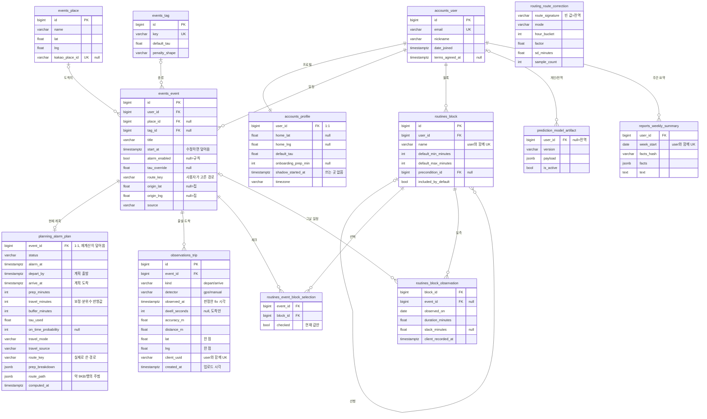

# DB 스키마 점검과 정리안 (Phase C1·C2)

- 작성 2026-10-13 · 기준 코드 `front-iter2` `7a0c920` · 공용 DB Neon Postgres 18.6
- 점검 방법: 읽기 전용 세션(`SET SESSION CHARACTERISTICS AS TRANSACTION READ ONLY` 후 `transaction_read_only = on` 확인)에서 `pg_catalog`·`information_schema`·`django_migrations` 만 읽었다. 행 내용·접속 정보는 읽지도 적지도 않았다. 행 수는 통계 추정치(`n_live_tup`)다.
- 이 문서는 설계다. 코드·마이그레이션은 바꾸지 않았다. 구현은 Phase C 빌드 단계에서 §7(추가 변경)만 한다.

## 0. 요약

- 공용 DB 는 이 브랜치 모델과 컬럼·NULL·DB 기본값·제약·인덱스가 모두 같다. 다른 점은 하나다. 이 브랜치의 `reports.0001_initial`(주간 요약 `reports_weekly_summary`)이 아직 적용되지 않았다. main 에 머지되어 Render 가 배포할 때 만들어진다.
- 지금 남는 것: 일정, 그 일정의 **현재** 알람 계획, 출발·도착 관측, 준비 블록 관측.
- 지금 남지 않는 것: 계획 이력(재계산이 덮어씀), 알람 울림·끄기·미루기, 반경 진입 시각, 사용자 입력의 변경 이력, 앱과 주고받은 요청·응답, LLM 호출.
- 지금 할 일은 하위 호환 추가 변경 A1~A7 이다(§7). 이름 바꾸기·삭제·표 나누기·데이터 다시 쓰기는 제안 P1~P9 로만 둔다(§8). 박준하 님이 백엔드를 바꾸는 중이고, Render 는 배포할 때 공용 DB 에 migrate 를 돌린다.

## 1. 공용 DB 현황

DB 전체 약 9.8 MiB, `public` 테이블 21개(우리 앱 12개 + Django 9개). 마이그레이션 41개 적용, 마지막은 2026-10-05(`accounts.0004`, `events.0006`).

| 테이블 | 모델 | 행(추정) | 크기 |
| --- | --- | ---: | ---: |
| `accounts_user` | 사용자 `User` | 44 | 88 KB |
| `accounts_profile` | 프로필 `Profile` | 43 | 72 KB |
| `events_event` | 일정 `Event` | 41 | 136 KB |
| `events_place` | 장소 `Place` (전역 공유) | 14 | 56 KB |
| `events_tag` | 일정 종류 `EventTag` (시드) | 6 | 56 KB |
| `planning_alarm_plan` | 알람 계획 `AlarmPlan` (일정과 1:1) | 41 | 360 KB |
| `observations_trip` | 이동 관측 `TripObservation` | 15 | 104 KB |
| `routines_block` | 루틴 블록 `RoutineBlock` | 36 | 88 KB |
| `routines_event_block_selection` | 일정별 블록 선택 | 4 | 72 KB |
| `routines_block_observation` | 블록 관측 `BlockObservation` | 12 | 120 KB |
| `prediction_model_artifact` | 모델 아티팩트 | 0 | 56 KB |
| `routing_route_correction` | 경로 보정 (전역) | 0 | 16 KB |
| `reports_weekly_summary` | 주간 요약 (이 브랜치) | 없음 | — |

- Django 쪽: `auth_permission` 68, `django_content_type` 17, `django_session` 0(JWT 라 안 씀), `django_admin_log` 0, 그룹·권한 연결 표 0.
- `planning_alarm_plan` 이 행당 약 9 KB 로 가장 크다. 경로 좌표 JSON(`route_path`, `alt_route_path`) 때문이다.
- 학습 산출물이 비어 있다. `prediction_model_artifact`·`routing_route_correction` 이 0행이라 `train_models` 가 공용 DB 에서 돈 적이 없다(backend-requests R-3).
- FK 16개는 모두 `DEFERRABLE INITIALLY DEFERRED` 이고 DB 수준 `ON DELETE` 가 없다. 연쇄 삭제는 Django ORM 이 한다. 자식 행이 있는 행을 원시 SQL 로 지우면 커밋 때 FK 오류가 나므로, 보존 정책의 삭제도 관리 명령(ORM)으로 한다.
- `kind`·`detector`·`status` 같은 선택지는 DB `CHECK` 가 아니다. 선택지 값을 더해도 마이그레이션 SQL 이 없다.
- 모델 비교에서 `terms_agreed_at`·`alarm_enabled` 가 "DB 기본값 없음"으로 보이지만 `db_default=None` 은 Postgres 에서 기본값 없음과 같다. 차이가 아니다.

## 2. 현재 ER

주요 컬럼만 그렸다(전체는 각 앱 `models.py`). `user_id` 는 관측·계획·블록 표에도 있지만(사용자 격리용) 선은 생략했다. `reports_weekly_summary` 는 이 브랜치에만 있다.

## 3. 지금 기록되는 것과 안 되는 것

요구: 사용자별·일정별로 아래가 남고, 사용자가 넣은 값과 앱이 주고받은 요청·응답도 어딘가에 남아 나중에 학습에 쓸 수 있어야 한다.

| 요구 항목 | 지금 | 빈 곳 → 추가(§7) |
| --- | --- | --- |
| 사용자별 저장 | ✅ 거의 모든 표에 `user_id`. 장소·일정 종류·경로 보정은 일부러 전역 | — |
| 예정 시작 시각 | ✅ `events_event.start_at` | ⚠️ 수정하면 덮어씀. 계산 때의 값이 없음 → A2 |
| 계획 출발·도착(결정 시점) | ⚠️ `planning_alarm_plan` 1건이 재계산마다 `update_or_create` 로 덮어씀. 관측의 `planned_at` 도 현재 계획에서 계산 | ❌ 이력 없음 → A2 |
| 실제 출발·도착 | ✅ `observations_trip`(종류, 판별기, 판정 시각, 체류, 정확도, 거리) | ❌ 반경 진입 시각 → A1 |
| 알람 울림·끄기·미루기 | ❌ 기기에만 있다(`AlarmReceiver` 울림, `AlarmActivity` 끄기·5분 미루기·5분 뒤 소리 멈춤) | → A3 |
| 고른 경로·수단 | ⚠️ 사용자 선택 `events_event.route_key`, 실제 사용 `planning_alarm_plan.route_key`·`travel_mode`. 둘 다 덮어씀. 그때 보여 준 후보는 없음 | → A2(선택·사용), A4(보여 준 후보) |
| 준비 블록 실측 | ✅ `routines_block_observation`(블록별 소요·여유·병렬) | ⚠️ 일정별 체크는 현재 값만 → A2(계산 때 `prep_breakdown`) |
| 사용자가 넣은 값 | ⚠️ 프로필·일정·블록의 현재 값만 | ❌ 변경 이력 → A4(쓰기 요청 본문), A2 |
| 요청·응답 | ❌ gunicorn 접근 로그뿐(Render 로그, DB 아님) | → A4 |
| LLM 호출 | ⚠️ 성공한 문장만 `reports_weekly_summary`. 호출 수는 `/tmp` 파일 캐시라 잠들거나 재배포하면 0 | → A5 |

## 4. 학습에 비는 곳

- **G1. 비교 기준이 바뀐다.** `prediction/learning.py` `collect_travel_samples` 는 **지금** 계획의 `travel_minutes` 를 예측값으로 쓴다. 이동이 끝난 뒤 일정을 고치면 계획이 다시 계산되고, 사용자가 따른 계획이 아닌 값과 비교하게 된다. → A2 계획 이력.
- **G2. 카카오 원값이 없다.** `travel_minutes` 는 경로 보정과 τ 분위수가 들어간 값이다(`planning/models.py` `alt_faster_minutes` 주석). 그런데 경로 보정 학습은 이 값을 "카카오 예측"으로 놓고 비율을 다시 배운다. 보정이 붙은 값으로 보정을 배우는 셈이다. 카카오가 준 분(`route["minutes"]`)은 저장되지 않는다. → A2 에 `route_minutes_raw` 를 남긴다. 학습이 원값을 쓰게 바꾸는 것은 동작 변경이라 팀이 정한다.
- **G3. 도착 시각이 늦게 찍힌다.** §5.
- **G4. 알람 반응이 없다.** 알람 → 끄기 → 출발 중에서 "깨는 데 걸린 시간"과 "실제 준비 시간"을 나눌 수 없다. 리포트도 알람 수락·미루기·기상 지연을 재료가 없어 뺐다(task.md 8·9). → A3.
- **G5. 관측이 없는 이유를 모른다.** 추적이 안 돌았는지(권한·배터리 정책), 안 갔는지 구분할 수 없다. 빠진 관측이 무작위가 아니라 학습이 한쪽으로 쏠릴 수 있다. 이번 범위 밖이다(추적 시작·종료 기록은 다음 후보).
- **G6. 정답이 없다.** 강의실에 실제로 들어간 시각이 없어 지금 오차를 모른다. → §5 수동 도착.
- **G7. 학습을 돌린 적이 없다.** 아티팩트·보정이 0행이다. 재료를 모아도 배치가 돌아야 쓰인다(R-3).

## 5. 도착 시각 편향과 수동 정답 도착

근거: `pm-docs/iter2/team18_iter2_sensor_research.md` 2·5절, 앱 `TripGeofence.kt`·`TripTrackingService.kt`.

### 5-1. 지금 찍히는 방식

- `TripGeofence.offer` 는 목적지 50 m 안이 2회 연속이고, 처음 들어온 fix(`arrivalEnteredAtMillis`)부터 120초 이상 지나면 `TripEvent.Arrived(fix, dwellMillis = fix 시각 − 진입 시각)` 를 낸다.
- `TripTrackingService.record` 는 `observed_at = fix.atMillis`, `dwell_seconds = dwellMillis / 1000` 으로 올린다. 진입 시각은 앱 메모리에만 있다가 버려진다.
- 추적 마감(일정 시작 1시간 뒤)에 걸리면 120초를 못 채운 채 확정한다(`dwell_seconds < 120`).

### 5-2. 편향

- 기록된 도착은 반경 진입보다 **최소 2분 늦다.** 실내에서 fix 가 버려지면 더 늦다.
- 학습: 실제 이동 = 도착 − 출발(`learning.py`)이라 도착 쪽 지연만큼 길게 배운다. 출발도 집 150 m 밖 fix 시각이라 현관보다 늦게 찍힌다. 그래서 이동 시간의 편향은 두 지연의 차이다(규칙에서 추론, 실측 아님).
- 리포트: 여유 = 약속 − 도착(`reports/services.py`)이라 여유를 항상 2분 이상 작게, 지각을 많게 본다.
- 이 2분이 "건물 → 강의실" 이동을 일부 메우지만 크기는 통제되지 않는다.

### 5-3. 이번에 하는 것과 하지 않는 것

- 한다(A1): 도착 관측에 `entered_at`(반경 진입 시각)을 함께 받는다.
- 하지 않는다: `observed_at` 계산, `learning.py`·`reports/services.py` 의 사용. 보정은 팀 결정이다.
- 참고: 앱이 `dwell_seconds` 를 "판정 fix − 진입"으로 보내므로 기존 행도 `observed_at − dwell_seconds` 로 진입 시각을 1초 안쪽 오차로 복원할 수 있다. 행을 고치는 일은 데이터 다시 쓰기라 P6 에 둔다.

### 5-4. 보정 선택지 (팀 결정, 센서 리서치 7절 5번)

| 안 | 내용 | 영향 |
| --- | --- | --- |
| O1 | 그대로 두고 `entered_at` 만 쌓는다 | 바뀌는 것 없음. P12 정답과 비교할 재료를 모은다 |
| O2 | 학습·리포트가 `entered_at`(없으면 `observed_at − dwell_seconds`)을 도착으로 쓴다 | "건물 도착" 기준으로 일관된다. 지난 학습값·리포트를 다시 계산해야 한다 |
| O3 | 진입 + 장소별 "건물 → 착석" 평균 | "강의실 도착" 기준. P12 정답이 먼저 필요하다 |
| O4 | 앱이 `observed_at` 을 진입 시각으로 보낸다 | 비추천. 한 컬럼에 의미가 다른 값이 섞인다 |

권장: 지금은 O1, P12 결과를 보고 O2 나 O3.

### 5-5. 수동 정답 도착이 GPS 도착과 같이 들어가나 (P12)

- **저장은 된다.** 유일 제약은 `(user, client_uuid)` 하나이고 `(event, kind)` 는 일반 인덱스다. 같은 일정에 `detector=gps` 도착과 `detector=manual` 도착이 함께 들어간다. 시리얼라이저와 `ObservationBatchView` 도 막지 않는다.
- **쓰는 쪽에서 섞인다.** `learning.py` 와 `reports/services.py` `_first_by_kind` 는 판별기를 보지 않고 종류별로 **가장 이른 행**을 쓴다. 수동 탭이 GPS 확정보다 이르면 정답이 학습·리포트에 들어가고, 늦으면 무시된다. 어느 쪽이 될지 시각 순서가 우연히 정한다.
- **좌표가 필요하다.** `lat`·`lng`·`accuracy_m`·`distance_m` 이 NOT NULL 이라 수동 행도 마지막 fix 한 점을 담아야 한다. 한 점이라 N19(이동 궤적 저장 금지)와는 맞는다. fix 없이 받으려면 P9.
- 선택지(설계만, UI 없음). P12 정답 수집을 시작하기 **전에** 정한다.
  - (a) 정답을 새 종류 값으로 받는다(예 `arrive_truth`, 첫 주 출발 정답은 `depart_truth`). 기존 소비 쪽은 `depart`/`arrive` 만 보므로 지금 동작이 그대로다. DB 변경은 없고 시리얼라이저 선택지만 늘어난다. 앱 DTO 의 `kind` 는 String 이라 목록 조회도 깨지지 않는다.
  - (b) `kind=arrive, detector=manual` 로 받고 학습·리포트가 `detector=gps` 만 쓰게 바꾼다. 동작 변경이라 팀 결정이다.
- 센서 리서치 5절의 다른 후보 시각(실내 진입·층 도달·Wi-Fi 일치)도 같은 원칙으로 **판정 결과와 시각만** 올린다. 기압 시계열·AP 목록·좌표 궤적은 기기 밖으로 내보내지 않는다(N19).

## 6. 더 깔끔한 정리 (이름·묶음·admin)

### 묶음

데이터가 생기는 순서대로 admin 섹션을 놓는다. "입력 → 계획 → 실측 → 학습 → 리포트".

| 섹션 | 앱 | 표 |
| --- | --- | --- |
| 1. 계정 | accounts | 사용자, 프로필 |
| 2. 일정 | events | 일정, 장소, 일정 종류 |
| 3. 루틴 | routines | 루틴 블록, 일정별 블록 선택, 블록 관측(→ P2 에서 5번으로) |
| 4. 알람 계획 | planning | 알람 계획(현재), **계획 이력**(A2) |
| 5. 실측 기록 | observations | 이동 관측, **알람 기록**(A3) |
| 6. 학습 | prediction, routing(섹션 두 개를 나란히) | 모델 아티팩트, 경로 보정 |
| 7. 리포트 | reports | 주간 요약, **LLM 호출**(A5) |
| 8. 운영 | common | **API 요청 기록**(A4) |

### 이름 규칙

- 시각 `_at`, 날짜 `_on`, 단위는 접미사(`_minutes`, `_seconds`, `_m`). 새 표는 처음부터 이 규칙을 쓴다.
- 지금 어긋난 것: 계획값 `depart_by`·`arrive_at` 과 실측값 `observed_at` 이 이름만으로 구분되지 않는다. `onboarding_prep_min` 만 `_min` 이다. 바꾸는 일은 P1 이다.
- 계획 이력(A2)은 `AlarmPlan` 과 **같은 필드 이름**을 쓴다. 값을 그대로 복사하고, 나중에 이름을 바꿀 때(P1) 두 표를 함께 바꾼다. 같은 값이 표마다 다른 이름이면 더 헷갈린다.
- 테이블 이름은 바꾸지 않는다. `db_table` 을 바꾸면 그 순간 구버전 코드가 깨진다. 직관성은 admin 표시 이름(`verbose_name`)으로 맞춘다.

### Django admin

- 기록 표(A2~A5)는 읽기 전용이다(추가·수정·삭제 없음). 목록에 사용자 이메일·일정 제목·한국 시각, 종류·날짜 필터를 둔다.
- 일정 화면에 계획 이력·이동 관측·알람 기록을 읽기 전용 inline 으로 붙인다. 한 일정의 "계획 → 알람 → 출발 → 도착" 이 한 화면에 보인다.
- 섹션 번호는 각 `AppConfig.verbose_name` 으로 붙인다. 코드만 바뀌고 마이그레이션은 생기지 않는다.

## 7. 지금 할 추가 변경 (하위 호환, Phase C 빌드)

### 7-0. 지킬 조건

- 새 컬럼은 `null=True` 이거나 `db_default` 가 있다. 파이썬 `default` 만 준 NOT NULL 컬럼은 만들지 않는다(구버전 코드의 INSERT 가 500, `events/models.py` `route_key` 주석).
- 새 표와 새 컬럼만 만든다. 기존 컬럼·표의 이름·타입·제약은 그대로다. 데이터 다시 쓰기(`RunPython`)는 없다.
- API 는 응답 필드를 더하기만 하고, 새 요청 필드는 선택이다. 구버전 앱이 보내지 않아도 된다.
- 마이그레이션 번호: `observations.0003`, `planning.0009`, `reports.0002`, `common.0001`. 머지 직전에 main 의 최신 번호를 보고 겹치면 다시 만든다.
- 그래서 Render 가 마이그레이션을 먼저 돌리든 구버전 인스턴스가 잠깐 더 돌든 둘 다 동작한다.

### A1. 이동 관측 `entered_at` (반경 진입 시각)

- 컬럼: `observations_trip.entered_at timestamptz NULL`.
- 검증: 도착에만 받는다(출발에 있으면 400, `dwell_seconds` 와 같은 규칙). `entered_at ≤ observed_at`, 차이는 `MAX_DWELL_SECONDS`(7200초) 이하.
- 앱: `TripGeofence` 가 진입 시각을 `TripEvent.Arrived`(마감 확정 포함)에 싣는다 → `TripTrackingService.record` → `TripObservationInput.enteredAt`(nullable, `entered_at`) → 기존 `TripObservationQueue`. 큐에 남은 옛 항목은 값이 없어도 된다.
- 응답: 관측 목록에 `entered_at` 을 더한다.
- 바꾸지 않는 것: `observed_at` 계산, `learning.py`·`reports/services.py`.
- 테스트: 서버(저장, 출발 거절, 순서·상한, 재전송 멱등), 앱(진입 시각 전달, 직렬화 이름).

### A2. 계획 이력 `planning_plan_revision` (`PlanRevision`)

- 쓰는 곳: `compute_and_store` 의 `_upsert` 바로 뒤, 같은 트랜잭션. 그 일정의 마지막 이력과 결정값(`status`, `alarm_at`, `depart_by`, `arrive_at`, 분 셋, `tau_used`, `route_key`, `event_start_at`)이 다를 때만 새 행을 만든다. 같은 값으로 다시 계산한 것은 남기지 않는다.
- 컬럼
  - `user` FK, `event` FK(CASCADE, `AlarmPlan` 과 같음), `computed_at`.
  - `AlarmPlan` 에서 같은 이름으로 복사: `status`, `alarm_at`, `depart_by`, `arrive_at`, `prep_minutes`, `travel_minutes`, `buffer_minutes`, `tau_used`, `on_time_probability`, `confidence_basis`, `prep_source`, `prep_breakdown`, `total_quantile_minutes`, `travel_mode`, `travel_source`, `route_key`, `route_detail`, `route_distance_m`. 경로 좌표(`route_path`, `alt_route_path`)는 크기 때문에 넣지 않는다.
  - 새로 넣는 값: `event_start_at`(계산 때 일정 시작), `requested_route_key`(그때 `Event.route_key`), `route_minutes_raw`(카카오 원값, G2), `trigger`(부른 곳: create / update / recompute / import / profile / blocks, 없으면 빈 값). 지금 `compute_and_store` 를 부르는 곳이 이 여섯이다.
- 결정 시점(저장하지 않고 이렇게 고른다): 그 일정의 첫 알람 울림(A3) 전에 계산된 마지막 이력. 알람이 없었으면 실제 출발 전 마지막 이력. A3 의 `alarm_at`(기기에 등록돼 있던 시각)과 맞춰 볼 수 있다.
- API 와 학습·리포트는 그대로다. 학습이 이 표를 쓰게 바꾸는 것은 팀 결정이다.
- 테스트: 생성, 값이 바뀐 재계산, 같은 값 재계산(행이 늘지 않음), 실패 상태(`route_failed` 등)도 남음.

### A3. 알람 기록 `observations_alarm_log` (`AlarmLog`)

- 한 행이 알람 사건 하나다.
- 컬럼: `user` FK(CASCADE), `event` FK(SET_NULL, null — 일정이 지워져도 기상 반응은 남긴다, 블록 관측과 같음), `kind`, `occurred_at`(기기 시각), `alarm_at`(그때 기기에 등록돼 있던 알람 시각, null), `snooze_minutes`(미루기만, null), `source`(app / server), `client_uuid`(user 와 함께 유일, 서버 기록은 서버가 만든다), `created_at`(서버 수신).
- `kind`: `scheduled`(등록·변경) · `fired`(울림) · `snoozed`(미루기) · `dismissed`(끄기) · `silenced`(5분 뒤 소리 자동 멈춤) · `enabled`/`disabled`(켬·끔).
- 앱: `AlarmReceiver.onReceive` → fired, `AlarmActivity.dismiss`/`snooze` → dismissed/snoozed(5분), 자동 멈춤 → silenced, `AlarmScheduler.sync` 는 등록 시각이 바뀐 일정만 scheduled. 새 큐 `AlarmLogQueue`(`TripObservationQueue` 와 같은 방식) → `POST /api/alarm-logs/batch`. 같은 `client_uuid` 는 저장하지 않고 duplicated 로 센다(관측 배치와 같은 규칙).
- 서버: `PATCH /api/events/{id}` 로 `alarm_enabled` 가 바뀌면 enabled/disabled 를 `source=server` 로 남긴다.
- 조회 API 는 이번에 만들지 않는다(학습·admin 용).
- 테스트: 배치 저장, 멱등, 남의 일정 거절, 켬·끔 서버 기록, 앱 큐 직렬화.

### A4. API 요청 기록 `common_api_request_log` (`ApiRequestLog`)

- `apps.common` 을 `INSTALLED_APPS` 에 넣고(지금은 없다) 모델과 미들웨어를 둔다. DRF 가 인증한 사용자는 뷰가 끝난 뒤 미들웨어의 `request.user` 에 보인다.
- 컬럼: `created_at`(인덱스), `user` FK(null, CASCADE), `method`, `route`(URL 패턴, 예 `api/events/<int:pk>`), `object_id`(경로의 pk, null), `status_code`, `duration_ms`, `app_version`(`X-App-Version`, 없으면 빈 값), `query`·`request_body`·`response_body`(jsonb, 정리한 값, `db_default` 빈 객체), `error_code`(공통 오류 형식의 code, 빈 값 가능).
- 정리 규칙
  - 비밀: `password*`, `token`, `access`, `refresh`, `Authorization`, `*_key`, `secret` 은 값을 지운다.
  - 좌표: `lat`, `lng`, `*_lat`, `*_lng`, `x`, `y`, `path`, `points`, `route_path`, `alt_route_path` 는 값을 지운다(N19). 이동 중 현재 위치를 보내는 `routes/live` 가 쌓여 궤적이 되는 것을 막는다. 장소·출발지 값은 이미 각 표에 있다.
  - 크기: 요청 8 KB, 응답 16 KB 를 넘으면 자르고 `_truncated: true`.
- 남기지 않는 것: `/api/health`(Render 헬스 체크가 수시로 부른다), `/admin/`, `places/staticmap`(이미지). 가입·토큰·비밀번호 검사는 본문 없이 메타만.
- 요청 본문은 쓰기(POST/PATCH/PUT/DELETE)만, 응답 본문은 `routes/candidates`(그때 보여 준 후보)와 일정 생성·수정·재계산(그 결과 계획)만 남긴다.
- 기록이 실패해도 응답은 그대로 나간다(예외를 삼키고 경고 로그).
- 앱(선택): OkHttp 인터셉터로 `X-App-Version` 을 붙인다.
- 테스트: 비밀·좌표 지움, 제외 경로, 쓰기 본문, 자르기, DB 오류에도 정상 응답, 익명 요청.

### A5. LLM 호출 기록 `reports_llm_call` (`LlmCall`)

- 이유: Phase B 리뷰 1·2번(`phaseB-review.md`). 사용자별 상한이 `/tmp` 파일 캐시라 잠들거나 재배포하면 0 부터 다시 세고, 전체 하루 상한이 없다.
- 컬럼: `user` FK(CASCADE), `day`(서버 시간대 오늘, `timezone.localdate()`), `week_start`, `outcome`(pending / ok / 실패 종류 / invalid), `model`(`db_default=""`), `facts_hash`, `duration_ms`(null), `created_at`. 인덱스 `(day)`, `(user, day)`.
- 상한: 부르기 직전에 센다. 오늘 전체 행 수가 `LLM_GLOBAL_DAILY_LIMIT` 이상이거나 이 사용자 행 수가 `LLM_USER_DAILY_LIMIT`(지금 30 그대로) 이상이면 고정 문장을 쓴다. 아니면 `pending` 행을 만들고 부른 뒤 결과로 바꾼다.
- 전체 상한은 settings 값이다(환경변수, 기본 하루 100회). 활성 사용자 10명이 하루 몇 번 여는 정도를 덮고, 계정을 여러 개 만들어도 이 이상은 부르지 않는다.
- 셀 수 없으면(DB 오류) 지금처럼 부르지 않는다(fail-closed). 상한에 걸린 시도는 행을 만들지 않고 경고 로그만 남긴다.
- 두 요청이 같은 순간 세면 1~2회 넘칠 수 있다. 비용 방어용 상한이라 받아들인다.
- `llm_budget` 캐시는 더 쓰지 않는다. 설정 별칭 정리는 P3.
- 가입 빈도 제한은 백엔드 범위라 구현하지 않고 `backend-requests.md` R-8 로 넘겼다.
- 테스트: 사용자 상한, 전체 상한, 날짜 바뀜, DB 오류, 실패 결과 기록, 캐시를 비워도 상한 유지.

### A6. 주간 요약 `reports_weekly_summary`

- 이미 이 브랜치의 `reports.0001_initial` 이다. 공용 DB 에는 아직 없고, 머지 후 배포 때 생긴다. A5 는 그 다음 번호(`reports.0002`)다.

### A7. admin 정리 (코드만)

- A2~A5 표의 읽기 전용 admin, 일정 화면의 읽기 전용 inline, 섹션 번호(§6). DB 영향이 없다.

## 8. 제안만 (마이그레이션 계획, 이번에 하지 않음)

### 8-0. 공통 절차

공용 DB 는 Render 가 배포할 때 `migrate` 를 돌리고, 그동안 구버전 인스턴스가 잠깐 더 돈다. 그래서 단계마다 **구버전·신버전 코드가 둘 다 동작**해야 한다. 한 단계 = PR 하나 = 배포 하나로, 박준하 님과 순서를 맞춘다.

1. 늘리기: 새 컬럼·표를 null 또는 `db_default` 로 추가한다. 코드는 옛 자리와 새 자리에 둘 다 쓴다.
2. 옮기기: 관리 명령으로 기존 데이터를 채운다. 작은 배치로, 다시 돌려도 같은 결과가 나오게 한다. 마이그레이션 안에서 하지 않는다(부팅 때 돌아 시간 제한·되돌리기가 어렵다).
3. 바꾸기: 읽기를 새 자리로 옮긴다. 응답 JSON 이름은 그대로 둬서 앱은 바뀌지 않는다.
4. 줄이기: 모든 배포가 새 코드가 된 뒤, 옛 컬럼을 nullable 로 바꾸고 다음 배포에서 지운다.

각 단계는 Neon 브랜치(복사본)에서 먼저 migrate 해 본다.

### 8-1. 항목

| ID | 제안 | 절차·주의 |
| --- | --- | --- |
| P1 | 이름 바꾸기: `depart_by`→`planned_depart_at`, `arrive_at`→`planned_arrive_at`(계획·이력 함께), `onboarding_prep_min`→`onboarding_prep_minutes` | 1~4 단계. 응답 이름은 시리얼라이저 `source` 로 유지. 얻는 것이 작아 팀이 원할 때만. 테이블 이름은 바꾸지 않는다 |
| P2 | 블록 관측을 `observations` 앱으로(실측을 한 섹션에) | `SeparateDatabaseAndState` 로 모델 상태만 옮기고 `db_table` 유지 → SQL 없음. URL 유지 |
| P3 | 안 쓰는 것 정리: `Profile.shadow_started_at`(쓰는 코드 없음, 응답에 읽기 전용), `Event.Source.NLP`(선택지만), `route_summary`·`route_detail` 겹침, `llm_budget` 캐시 별칭 | 앱이 읽는지 먼저 확인 → 코드에서 안 씀 → 다음 배포에서 삭제 |
| P4 | 계획에서 경로 좌표 떼기: `route_path`·`alt_route_path` → `planning_plan_route`(계획과 1:1) | 목록 조회 행이 약 9 KB → 1 KB. 1~4 단계, 응답 모양 유지 |
| P5 | 현재 계획과 이력을 한 표로(`is_current`) | 장기 과제. A2 를 한 학기 써 본 뒤 판단 |
| P6 | 데이터 다시 쓰기: 과거 도착 `entered_at = observed_at − dwell_seconds`, 이력 첫 행(지금 계획 1건씩, `trigger=backfill`), §5-4 O2·O3 를 고르면 학습값 재계산 | 팀 결정 후 관리 명령으로. 되돌릴 수 있게 바꾼 행 id 를 남긴다 |
| P7 | 제약 강화: `kind`·`detector`·`status` CHECK, 일정당 GPS 도착 1건(부분 유일) | 기존 데이터 검사 → `NOT VALID` 로 추가 → `VALIDATE`. 구버전이 새 값을 쓰면 실패하므로 마지막에 |
| P8 | DB 수준 `ON DELETE` | Django 6.0 `db_on_delete` 로 올릴 때. 원시 SQL 정리도 안전해진다 |
| P9 | 관측 좌표 4개 nullable(fix 없는 수동 정답) | 쓰기는 하위 호환이지만 앱 DTO(`lat: Double`)·학습이 null 을 받게 먼저 고친다 |

## 9. 용량 추정과 보존 정책 (Neon 무료 플랜)

Neon 무료 플랜은 프로젝트당 저장 1 GB, 계산 월 100 CU-시간, 공용 전송 월 5 GB 다([Neon FAQ](https://neon.com/faqs/free-plan-limits-and-quotas)). 저장 한도는 최근 0.5 GB 에서 늘었다([Neon blog](https://neon.com/blog/neon-free-plan-1-gb-per-project)). 우리 프로젝트에 어느 한도가 적용되는지는 콘솔에서 확인하지 않았으므로 **0.5 GB 안에서** 계획한다.

### 9-1. 추정

가정: 활성 사용자 20명, 하루 일정 2건, 남은 학기 70일 → 일정 2,800건. 행 크기는 인덱스를 포함한 어림값이다.

| 표 | 행 수 | 행당 | 합계 |
| --- | ---: | ---: | ---: |
| 알람 계획(지금 표, 실측 약 8.8 KB/행) | 2,800 | 9 KB | 25 MB |
| 계획 이력 A2(값이 바뀔 때만, 일정당 약 5) | 14,000 | 0.6 KB | 8 MB |
| 알람 기록 A3(일정당 약 4) | 11,200 | 0.25 KB | 3 MB |
| 이동 관측(일정당 2~3) | 7,000 | 0.4 KB | 3 MB |
| 블록 관측(일정당 약 5) | 14,000 | 0.3 KB | 4 MB |
| LLM 호출 A5(하루 최대 100) | 7,000 | 0.3 KB | 2 MB |
| API 요청 기록 A4(사용자당 하루 100~300건) | 하루 2천~6천 | 0.6 KB | 하루 1.2~3.6 MB |

- 요청 기록이 가장 크다. 30일만 두면 36~108 MB 에서 멈추고, 지우지 않으면 학기 말 85~250 MB 가 된다.
- 학기 말 합계: 지금 10 MB + 학습 재료 약 45 MB + 요청 기록(30일) 최대 108 MB → **약 165 MB**. 0.5 GB 안이다.
- 계산 시간: 기록 INSERT 는 이미 들어온 요청 안에서 한 번 더 쓰는 것이라 DB 를 따로 깨우지 않는다.

### 9-2. 보존

| 데이터 | 보존 | 이유 |
| --- | --- | --- |
| 일정·계획·계획 이력·관측·알람 기록·블록 관측·주간 요약 | 학기 끝까지 지우지 않음 | 학습 재료. 합쳐 50 MB 안팎 |
| API 요청 기록 | 30일 뒤 삭제 | 가장 크다. 학습에 쓰는 값은 A1~A3 표에 따로 남는다 |
| LLM 호출 | 90일 | 상한은 오늘 행만 센다. 나머지는 비용 확인용 |
| 계정 삭제 | 그 사용자의 행 전부(요청 기록 포함) ORM CASCADE | 개인정보 |
| 테스트 계정 | `scripts/purge_test_accounts.py` | 지금 있는 정리 도구 |

- 삭제는 관리 명령 `purge_logs`(ORM, `created_at` 인덱스)로 한다. Render 무료 플랜에는 cron 이 없으므로 A4 미들웨어가 프로세스마다 하루 한 번 부른다. 잠들었다 깨면 프로세스가 새로 뜨므로 요청이 있는 날은 돈다.
- DB 가 300 MB 를 넘으면 요청 기록 보존을 14일로 줄인다.
- 학기가 끝난 뒤 남길지 지울지는 팀이 정한다.

## 10. 배포와 마이그레이션 주의

- 공용 DB 에 로컬에서 `migrate` 하지 않는다. 이 브랜치의 마이그레이션은 main 에 머지된 뒤 Render 가 컨테이너를 띄울 때 적용된다(`backend/Dockerfile`: `migrate --noinput` 후 gunicorn).
- 머지 직전: main 의 같은 앱에 새 마이그레이션이 있으면 번호와 `dependencies` 를 다시 잡는다. `makemigrations --check` 로 빠진 것이 없는지 본다.
- 배포 뒤: 읽기만 하는 `scripts/db_status.py` 로 미적용이 0 인지 본다.
- 이번 점검에 쓴 일회용 스크립트는 지웠다. 공용 DB 에는 쓰기를 하지 않았다.

